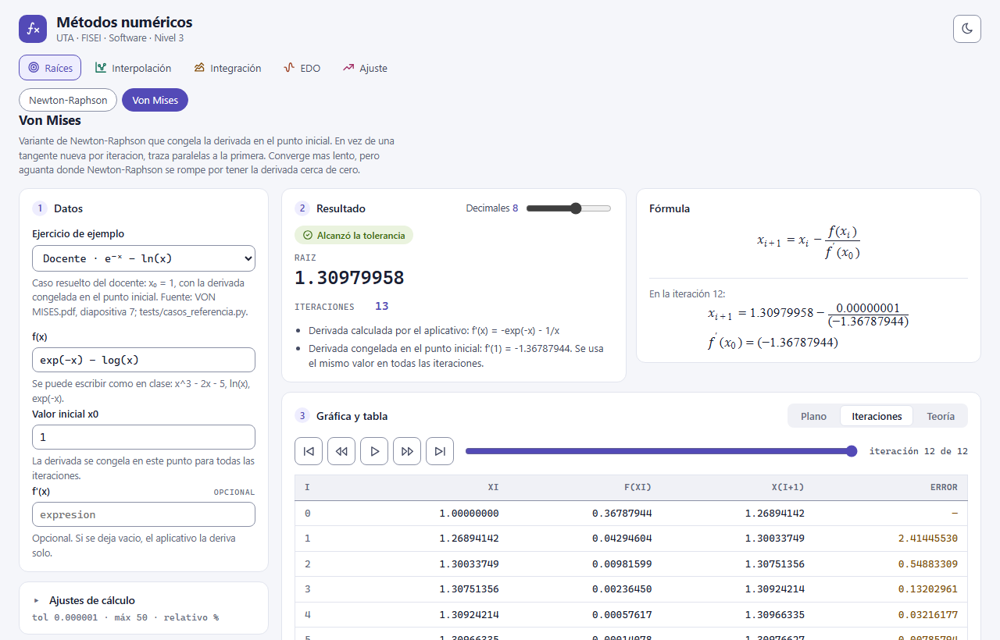
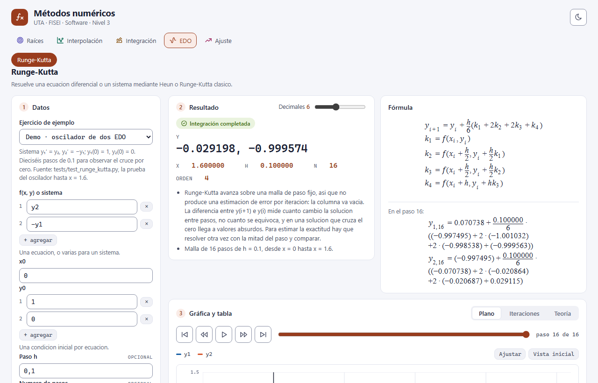

# Informe — Aplicativo de Metodos Numericos

Universidad Tecnica de Ambato · Facultad de Ingenieria en Sistemas, Electronica
e Industrial · Carrera de Software, Nivel 3.

Asignatura: **Metodos Numericos** (UTA-FISEI-SF-MP-UB-03-01).
Docentes: Ing. Henry Cumbal, Dr. Victor Penafiel.

Repositorio: <https://github.com/Osyanne/metodos-numericos-uta>

---

## 1. Objetivo

Construir un aplicativo que resuelva los ejercicios de la asignatura mostrando
**todas las iteraciones**, con precision ajustable y graficacion, y que pueda
crecer para cubrir los aproximadamente diez metodos del semestre.

El primer parcial cubre seis: Newton-Raphson, Von Mises, Interpolacion de
Newton, Interpolacion de Lagrange, Punto Medio y Runge-Kutta.

Como extension de U1, se agrego el **Metodo del Trapecio** a partir del
material de integracion numerica entregado. Conserva la misma entrada que Punto
Medio (`f(x)`, `a`, `b`, `n`), pero aproxima la curva con segmentos rectos.
Despues se sumo el **Metodo de Simpson**, a partir de `Método de Simpson.pdf`,
con la misma entrada y arcos de parabola en lugar de segmentos. Siguieron
**Simpson 1/3** (`Simpson1.pdf`, con `n` par) y **Simpson 3/8**, con arcos de
cubica y la aplicacion multiple de Chapra para los `n` que no son multiplo de 3,
y el **Ajuste por minimos cuadrados** (U4), con la tabla del docente. En total
son **once metodos**.

Sobre la interfaz se agregaron una **portada** con una tarjeta por metodo, la
navegacion por la direccion de la pagina y una pestana **Teoria** con la
explicacion de cada metodo, para que el aplicativo se pueda estudiar y no solo
usar.

No hubo especificacion escrita ni rubrica —el docente confirmo que no existe—,
asi que los requisitos se acordaron en clase y se dejaron por escrito en
[ESPECIFICACION.md](ESPECIFICACION.md), versionados junto al codigo. Ese
documento cumple la funcion que habria cumplido la rubrica.

## 2. Los metodos

### Newton-Raphson

Parte de una aproximacion `x₀` y en cada paso traza la tangente a la curva,
tomando como siguiente aproximacion el punto donde esa tangente corta el eje x:

```
x(i+1) = xᵢ − f(xᵢ) / f'(xᵢ)
```

Converge rapido, pero se vuelve problematico donde `f'(xᵢ)` se acerca a cero: la
tangente se aplana y la siguiente aproximacion se dispara lejos.

El aplicativo **deriva solo**, mostrando que derivada uso, y tambien acepta que
el usuario escriba la derivada a mano (R10).

### Von Mises

Es una variante de Newton-Raphson que **congela la derivada en el punto
inicial**:

```
x(i+1) = xᵢ − f(xᵢ) / f'(x₀)
```

Geometricamente, en vez de trazar una tangente nueva en cada paso, traza
**paralelas a la primera tangente**. Converge mas lento, pero no se rompe cuando
la derivada se acerca a cero en el camino.

> **Nota metodologica.** Al empezar se asumio que "Von Mises" era el metodo de
> las potencias para autovalores, que es el nombre con el que aparece en buena
> parte de la bibliografia. Fue un error, y obligo a rehacer parte del diseno:
> se habia previsto que algun metodo del parcial recibiria matrices. Se
> corrigio contra el material del docente (`VON MISES.pdf`). Ninguno de los
> metodos del parcial usa matrices.

Esta confusion tiene una consecuencia practica: si por descuido se recalcula la
derivada en cada paso, el metodo **sigue convergiendo y sigue pareciendo
correcto** —da una raiz valida, sin errores— pero deja de coincidir con los
numeros de clase. Por eso hay una prueba especifica que distingue las dos
tablas.

### Interpolacion de Newton

Construye el polinomio de menor grado que pasa por un conjunto de puntos, por
diferencias divididas, y lo entrega **expandido** (R8) y tambien en **forma de
Newton**, sin expandir, como lo escribe el docente.

Se implementaron las **cuatro variantes** —divididas, diferencias hacia
adelante, hacia atras y automatica—. El polinomio resultante es el mismo en
todas; lo que cambia es la tabla intermedia que se muestra. Hay una prueba que
verifica justamente esa equivalencia.

**El default es `divididas`**, y eso se decidio con el material del docente en
la mano: sus ocho diapositivas usan solo diferencias divididas. Antes el default
era `auto`, que con puntos equiespaciados elegia diferencias hacia adelante, asi
que el aplicativo mostraba una tabla correcta pero **distinta de la de clase**.

El metodo tambien devuelve la **forma anidada sin expandir** y los coeficientes
`a_i` de la diagonal, que es lo que el docente escribe en el pizarron junto al
polinomio expandido. La tabla de divididas pone cada diferencia en la fila de
su ultimo punto, como las diapositivas, asi que los `a_i` se leen sobre su
diagonal. Con diferencias finitas no aparecen en ninguna celda, y una nota lo
aclara.

### Interpolacion de Lagrange

Llega al mismo polinomio que Newton por otro camino: en vez de diferencias
divididas, arma un **polinomio base** `L_i(x)` por cada punto, que vale 1 en
`x_i` y 0 en todos los demas, y suma `f(x_i) * L_i(x)`.

Para el usuario la diferencia esta en la tabla. Aca no hay iteraciones que
converjan a nada: **cada fila es un paso del procedimiento**, con el numerador y
el denominador de su `L_i` a la vista, porque eso es lo que se corrige en clase.

Esto obligo a algo que ningun metodo anterior habia necesitado: **celdas de
texto**. Un `L_i` factorizado no es un numero, y hasta ahora toda celda pasaba
por una conversion a float que la habria borrado. El detalle esta en la seccion
de decisiones.

Como los dos metodos construyen el mismo polinomio, hay una prueba que los corre
sobre los mismos puntos y exige que coincidan. No dice cual esta mal si
difieren; dice que hay que mirar.

### Punto Medio

Aproxima una integral definida con rectangulos de igual ancho. La altura de
cada rectangulo se toma en el **centro** del subintervalo:

```
Delta_x = (b - a) / n
m_i = a + (i - 1/2) * Delta_x
I ~= sum(f(m_i) * Delta_x, i = 1..n)
```

La entrada es `f(x)`, los extremos `a`, `b` y el numero de subintervalos `n`.
Se exige `a < b` y un entero positivo `n <= 10000`. La tabla muestra una fila
por subintervalo, numerada desde 1, con el punto medio, `f(m_i)`, el area con
signo de ese rectangulo y la suma acumulada. El plano dibuja la curva y los
rectangulos, cuya altura puede ser negativa: se aproxima la integral con
signo, no la suma de areas absolutas.

Es un metodo de **malla fija**: recorre los `n` subintervalos y termina como
integracion completada. No persigue una tolerancia ni produce error por fila;
para comparar aproximaciones se puede resolver otra vez con el doble de
subintervalos. Los decimales solo cambian como se muestran los numeros.

El ejemplo del material del docente para el parcial 1 usa
`f(x) = 0.25*x^3 - x`, en `[-1.5, 2]`, con `n = 7`. Da `Delta_x = 0.5` y
puntos medios `-1.25, -0.75, -0.25, 0.25, 0.75, 1.25, 1.75`. La suma sin
redondear es `-0.205078125`; a cuatro decimales reproduce el `-0.2051` de la
diapositiva. La integral analitica es `-0.19140625`: es una referencia para
comprobar que refinar la malla mejora la aproximacion, no el resultado que
se espera con siete rectangulos. El caso se conserva en
`tests/casos_referencia.py`, como `PUNTO_MEDIO_RESUELTO`.

### Metodo del Trapecio

Divide el intervalo en `n` subintervalos de ancho `h = (b - a) / n` y une los
valores vecinos de la funcion con rectas. Los extremos se pesan una vez y los
puntos interiores dos veces:

```
I ~= h / 2 * [f(x_0) + 2 f(x_1) + ... + 2 f(x_(n-1)) + f(x_n)]
```

La tabla enseña los `n + 1` puntos, su peso, su aporte y la suma acumulada. El
plano sombrea trapecios con el segmento aproximante visible: no reutiliza los
rectangulos de Punto Medio. El caso del material, `exp(x^4)` en `[-1, 1]` con
`n = 5`, da `2.79929211`.

### Metodo de Simpson

Aproxima la curva con arcos de parabola: cada uno pasa por los extremos de un
subintervalo y por su punto medio. El material pide `n` par y trae dos casos.
Con `n = 2` hay una sola parabola sobre `[a, b]`:

```
I ~= (b - a) / 6 * [f(a) + 4 f((a + b)/2) + f(b)]
```

Con `n > 2`, `[a, b]` se parte en `n` subintervalos de ancho `h = (b - a) / n`
y cada uno aporta su punto medio `m_i`:

```
I ~= (b - a) / (6n) * [f(x_0) + 4 sum f(m_i) + 2 sum f(x_i) + f(x_n)]
```

El primer caso es el segundo con un solo subintervalo, y asi se programo: una
sola formula, con `n = 2` tratado como un subintervalo. La tabla muestra cada
punto con su nombre (`x0`, `m1`, `x1`, ...), su peso 1, 4 o 2, y la suma del
corchete que el docente escribe antes de multiplicar. El plano sombrea los
arcos de parabola. Los casos del material, `sqrt(5 + x^3)` en `[0, 1]`, dan
`2.29015714` con `n = 2` y `2.290473375` con `n = 4`.

Una prueba corre los tres metodos de integracion sobre la misma malla y exige
que Simpson sea `(Trapecio + 2 * Punto Medio) / 3`: si no se cumple, una de las
tres reglas esta mal.

### Simpson 1/3

Es la regla de `Simpson1.pdf`: una parabola por cada **dos** subintervalos, con
`n` par y `dx = (b - a) / n`. Los `n + 1` puntos van con pesos `1, 4, 2, 4, ...,
2, 4, 1`:

```
I ~= dx / 3 * [f(x_0) + 4 f(x_1) + 2 f(x_2) + ... + 4 f(x_(n-1)) + f(x_n)]
```

El ejercicio del docente, `exp(x^2)` en `[0, 1]` con `n = 10`, da el corchete
`43.880442` y la integral `1.4626814`; el pizarron escribe `1.4626`, truncada.

No es otra regla que el Metodo de Simpson: solo cuenta `n` de otra forma. El
Metodo de Simpson evalua ademas el punto medio de cada subintervalo, asi que con
`n` par (4 o mas) da exactamente lo mismo que Simpson 1/3 con `2n`, y con `n = 2`
los dos son una sola parabola. Una prueba lo exige con `sqrt(5 + x^3)`: `n = 4`
contra `n = 8` dan el mismo corchete, `54.97136101`. Con `n` impar no hay regla
1/3 posible, y el aplicativo lo dice y manda a Simpson 3/8.

### Simpson 3/8

Cambia la parabola por una **cubica** que pasa por cuatro nodos equiespaciados:
un tramo de tres subintervalos. Con `n = 3` es una sola cubica,
`(b - a) * [f(x_0) + 3 f(x_1) + 3 f(x_2) + f(x_3)] / 8`, y con `n` multiplo de 3
se encadenan tramos, donde los nodos de union pesan 2 y la tabla lee
`1, 3, 3, 2, 3, 3, 2, ..., 3, 3, 1`.

Lo que lo distingue es la **aplicacion multiple** del docente (Chapra, ejemplo
21.6): con `n` que no es multiplo de 3 se combinan las dos reglas, la 1/3 en los
primeros 2 o 4 subintervalos y la 3/8 en el resto. Con `f(x) = 0.2 + 25x − 200x² +
675x³ − 900x⁴ + 400x⁵` en `[0, 0.8]` y `n = 5` salen dos tramos, uno por regla:
`0.3803237` de la 1/3 y `1.2647535` de la 3/8, que suman **`1.6450772`** contra
el valor exacto `1.640533`. Eso obligo a que el resultado no tenga un solo
corchete: `result.tramos` lista el de cada regla, y `corchete` y `factor` solo
quedan cuando hay un unico tramo. La tabla repite el nodo de union, una vez por
regla, con dos columnas de texto (`nodo` y `regla`) que dicen a cual pertenece
cada fila. Con `n = 1`, `2` y `4` no hay tramo de 3/8 y el metodo falla
diciendolo.

### Ajuste por minimos cuadrados

A diferencia de los demas, no itera ni recorre una malla: dados unos puntos,
calcula **una sola vez** la recta `y = m x + b` que minimiza la suma de los
cuadrados de los residuos, y la correlacion `r`, de las sumas `Sx, Sy, Sxy, Sxx,
Syy` de la tabla del docente:

```
m = (n Sxy - Sx Sy) / (n Sxx - Sx^2)        b = (Sy - m Sx) / n
```

El ejercicio del docente, con los puntos `(1, 2)`, `(1.5, 3.2)`, `(2, 4.1)`,
`(2.5, 4.9)` y `(3, 5.9)`, tiene totales `10.00`, `20.10`, `44.95`, `22.50` y
`89.87`, y da `m = 1.90`, `b = 0.22` y `r = 0.9976`. La columna de error de cada
fila es el **residuo al cuadrado** (`0.0144`, `0.0169`, `0.0064`, `0.0049`,
`0.0004`) y suman `0.0430`. Las sumas se hacen con fracciones exactas sobre el
decimal de cada dato: asi sale `m = 1.9` y no `1.8999999999999995`.

Ademas de la recta hay tres modelos que se linealizan con `log` en base 10, como
en clase: potencial `y = b x^m`, exponencial `y = b e^(m x)` y logaritmico `y = m
log x + b`. El modelo se elige en una lista desplegable, que es el primer campo
de la API que declara sus opciones (`choices`).

### Runge-Kutta

Resuelve `y' = f(x, y)` avanzando sobre una malla de paso fijo. Se
implementaron los ordenes **2 (Heun)** y **4 (clasico)**, con 4 por defecto, y
admite **sistemas de ecuaciones** (R9): las componentes se evaluan
simultaneamente en cada etapa, que es lo que distingue resolver un sistema de
resolver dos ecuaciones por separado.

La malla se define con `h` y `n`, con `h` y `xf`, o con `n` y `xf`.

## 3. Arquitectura

El aplicativo tiene tres capas y una regla que las ordena: **el nucleo es el
unico que hace matematica**.

```
core/     nucleo numerico puro, sin nada de web
api/      capa HTTP (FastAPI), traduce entre JSON y el nucleo
web/      interfaz en el navegador, sin librerias externas
```

### Por que la interfaz no calcula nada

La interfaz **nunca evalua `f(x)`**. Cuando el usuario hace zoom en el plano y
la curva necesita mas puntos, se los pide al nucleo por `POST /api/plot/sample`.

Podria parecer mas simple evaluar la expresion en JavaScript. El problema es que
serian **dos analizadores de expresiones distintos**, y dos analizadores pueden
discrepar justo en lo que el docente revisa: en como interpretan `2x`, o `x^3`,
o el orden de las operaciones. Un mismo ejercicio daria un numero en la tabla y
otro en la grafica.

### Como se agrega un metodo

Crear un archivo en `core/methods/`, construir un `MethodSpec` y registrarlo.
El registro lo descubre solo al importar el paquete, y **la interfaz dibuja el
formulario a partir de los campos que el metodo declara**, sin saber de que
metodo se trata.

Eso cumple R3 para el nucleo y la API, y no como promesa:
`tests/test_extensibilidad.py` escribe un metodo nuevo en disco, recarga el
registro y verifica que aparezca en la API con sus campos y resolviendo, sin
haber tocado ningun archivo existente.

La interfaz pide un poco mas, y una prueba lo exige: el metodo necesita su
**formula** en `web/formulas.js` y su **teoria** en `web/teoria.js` (la prueba
«todo metodo de la API tiene su guia» de `tests/e2e/portada.spec.js` falla si
falta), y su familia en `FAMILIAS` de `web/app.js`, con su color en
`web/styles.css`, si es una familia nueva. Sin esas entradas el metodo aparece y
resuelve, pero sin formula ni pestana Teoria. Los ejercicios de ejemplo
(`web/presets.js`) son opcionales.

### Decisiones que vale la pena justificar

**`decimals` es formato, no calculo.** Los datos viajan con toda su precision y
se redondean al mostrarlos. Redondear al guardar degradaria la grafica, el CSV y
el remuestreo del zoom, y **no se puede deshacer**. Hay una prueba parametrizada
que compara `decimals=2` contra `decimals=10` en todos los metodos y verifica
que los valores calculados sean identicos.

**Una celda de la tabla es una medicion o una expresion.** Lagrange fue el
primer metodo que necesito mostrar texto —un `L_i` factorizado no es un
numero— y ahi aparecio una tuberia a medio terminar: `Column.numeric` existia
en el nucleo y en el esquema HTTP, y la interfaz ya sabia dibujar texto cuando
valia `false`, pero **nadie lo habia usado nunca**. Los dos eslabones del medio
seguian siendo solo numericos, asi que la tabla entera llegaba en blanco.

Se completo sin ampliar el contrato: `finite_or_none` **se dejo como estaba**,
porque es la misma funcion que valida los puntos de la curva del plano y ahi una
expresion sin evaluar no puede pasar. El texto va por una funcion aparte,
`cell_value`, que solo usan las celdas de la tabla. El `error` de una fila sigue
siendo siempre numerico.

**Una celda de texto sirve para algo mas que un polinomio.** Lagrange las
necesito para sus `L_i`; Simpson 3/8 las usa para `nodo` y `regla`, que dicen a
que regla pertenece cada fila cuando el nodo de union aparece dos veces. El
camino ya estaba hecho, y se probo de punta a punta tambien con la exportacion:
el CSV y el PDF escriben esas columnas tal cual.

**El resultado puede traer estructuras, y la interfaz decide donde van.**
`result.tramos` (una lista de objetos) y `result.totales` (un objeto) no caben en
una celda del resumen. La interfaz dibuja `totales` como la fila **Total** de la
tabla y no lista ninguno de los dos en el resumen; el CSV y el PDF cierran la
tabla con la fila `Total` cuando existe. Antes de fijarlo, el resumen de Simpson
3/8 mostraba «tramos −, —», un texto sin sentido.

**La portada y la direccion de la pagina.** La aplicacion abre en una portada
con una tarjeta por metodo, y la ruta vive en el hash: `#/` es la portada y
`#/metodo/<slug>` un metodo. Asi funcionan Atras, Adelante y los enlaces directos
sin un servidor que enrute, que es lo que hay en GitHub Pages. Un nombre
desconocido cae en la portada.

**La pestana Teoria es contenido fijo.** `web/teoria.js` guarda la explicacion de
cada metodo como HTML con formulas en MathML y graficas estaticas; la interfaz
no calcula nada para armarla. Sus ejemplos citan el ejercicio de la lista que
los verifica, y una prueba exige guia a todo metodo de la API.

**Sin librerias externas en el navegador.** El aplicativo tiene que funcionar
sin internet para poder demostrarlo en el laboratorio. El plano cartesiano esta
dibujado a mano sobre Canvas.

**La version en linea corre el mismo Python en el navegador.** GitHub Pages no
ejecuta Python, y pasar los metodos a JavaScript habria creado justo lo que la
arquitectura evita: dos implementaciones que pueden discrepar. Con Pyodide el
navegador ejecuta los mismos `core/` y `api/`; `pages/puente.js` intercepta los
pedidos a `api/` y se los pasa a la aplicacion FastAPI por ASGI. El costo es la
primera carga, que tiene que bajar Python, y que esa version necesita internet
la primera vez; la local sigue funcionando sin conexion.

La carga se hizo rapida de varias formas, sin cambiar lo que se ejecuta. La
interfaz **se pinta sin esperar a Python**: la lista de metodos sale de un
`catalogo.json` que se arma con la propia aplicacion FastAPI al construir el
sitio, y Python espera a que esa lista este pintada para arrancar. Las descargas
(`codigo.zip`, Pyodide, sus paquetes y los modulos de `web/`) empiezan desde el
HTML y corren en paralelo, y el puente reutiliza la aplicacion que ya construye
`api.main` en vez de crear otra. La pila del PDF (pillow, fonttools, micropip y
fpdf2) se baja solo al exportar el primer PDF. En la segunda visita, un service
worker (`sw.js`, generado al armar el sitio, con una cache nueva por cada
armado) guarda Pyodide, sus paquetes y el sitio, y el aplicativo funciona sin
red. El armado de Pages instala antes las dependencias de Python en el CI.

**Se ejecuta desde una copia del repositorio**, no como paquete instalado: la
interfaz vive en `web/`, al lado de `api/`. Si esa carpeta falta, el servidor no
arranca y lo dice, en vez de levantar una API sin pantalla.

## 4. Validacion

El detalle esta en [VALIDACION.md](VALIDACION.md). En resumen:

| | |
|---|---|
| Pruebas de Python | **339**, todas en verde |
| Pruebas de navegador (Playwright) | **218**, todas en verde |
| Instalacion probada en limpio | historial: clon nuevo, entorno virgen, 275 en verde y la interfaz sirviendo (2026-09-18, antes de Trapecio) |

La vara principal es la **tabla del docente**: `f(x) = e⁻ˣ − ln(x)` con `x₀ = 1`.
El aplicativo la reproduce fila por fila, columna por columna, incluida la de
error.



La distincion que se cuido en todas las pruebas: **ningun numero esperado se
obtuvo corriendo el aplicativo**. Salen del material del docente, de una
solucion analitica conocida, de un ejercicio resuelto a mano, o son propiedades
que tienen que cumplirse siempre. Escribir en la prueba lo que el codigo ya
devolvia congela tambien el error.

### Dos hallazgos que valen mas que las pruebas que pasan

**El ejercicio propuesto de la diapositiva 10 diverge, y esta bien que diverja.**
`4x³ − 18x² + 12x − 6 = 0` con `x₀ = 1.165`: la unica raiz real esta en
3.81699684, donde `f'` vale +49.42 contra los −13.65 congelados en el punto
inicial. El factor de amplificacion queda cerca de 4.6, muy por encima de 1, y
la sucesion se aleja. El aplicativo lo reporta con la causa escrita y **no
inventa una raiz**. Newton-Raphson resuelve el mismo ejercicio sin problema: el
obstaculo es del metodo, no del enunciado.

**Runge-Kutta no reporta error por iteracion, y esa columna vacia es la
respuesta correcta.** Lo que se mostraba era la diferencia entre `y(i+1)` e
`yᵢ`, que mide cuanto cambio la solucion entre pasos y no cuanto se equivoca.
Con el oscilador `y₁' = y₂`, `y₂' = −y₁` esa columna llegaba a **342 %** justo
donde la solucion cruza el cero, mientras el error verdadero contra `cos(1.6)`
era de **1.3 × 10⁻⁶**.



## 5. Limitaciones

Se declaran en vez de esconderse.

1. **Runge-Kutta no estima el error por iteracion.** Hacerlo bien requiere
   resolver otra vez con la mitad del paso y comparar, y antes hay que decidir
   si se estima error local o global y como agregarlo en un sistema. Se dejo
   fuera de este parcial por eso, no por olvido.
2. **La Teoria cubre los once metodos, pero la mantiene una persona.** Es
   contenido fijo en `web/teoria.js`: si cambia un metodo, su explicacion no se
   entera. Los ejemplos citan un ejercicio de la lista y la prueba de ese
   ejercicio los verifica, pero el texto alrededor no.
3. **Interpolacion de Newton trae las cuatro variantes** aunque el docente solo
   usa divididas, que es el default. Sobra codigo, pero no falta.
4. **Simpson 3/8 con `n` que no es multiplo de 3 mezcla dos reglas.** Es lo que
   hace el docente en la aplicacion multiple, pero el error ya no es el de una
   sola regla, y la columna de error va vacia como en toda malla fija. Para ver
   la exactitud hay que resolver otra vez con otro `n` y comparar.
5. **El ajuste solo tiene cuatro modelos** (recta, potencial, exponencial y
   logaritmico) y ninguno polinomico de grado mayor. Eran los del material.

## 6. Preguntas abiertas al docente

1. **¿La divergencia del ejercicio de la diapositiva 10 de `VON MISES.pdf` es a
   proposito?** El aplicativo la reporta correctamente, con la causa. Saber si
   el ejercicio busca eso cambia como se presenta en la sustentacion.

La pregunta sobre **que variante de Interpolacion de Newton** se esperaba quedo
cerrada al recibir las diapositivas del metodo: son **diferencias divididas**, y
ese es el default.

## 7. Conclusiones

El aplicativo cumple los once requisitos acordados, cada uno con la prueba que
lo respalda en [VALIDACION.md](VALIDACION.md).

Lo que mas costo no fue implementar los metodos, sino **darse cuenta de cuando
un resultado correcto se estaba presentando mal**. Los tres casos que aparecieron
—la raiz dibujada sobre un ejercicio que diverge, el 342 % de una solucion
exacta al sexto decimal, y una tabla que reaparecia bajo el nombre de otro
metodo— tenian en comun que el calculo estaba bien y la pantalla mentia. Ninguno
lo detecto la suite de pruebas del nucleo; los tres aparecieron al revisar la
salida contra lo que el usuario iba a entender.

De ahi la decision de que la columna de error de Runge-Kutta quede **vacia**. Un
numero que nadie puede interpretar es peor que ningun numero: invita a leerlo
como si significara algo.

## Referencias

- Material de clase: `VON MISES.pdf`, diapositivas 7 y 10.
- Material de clase: `Interpolacion del metodo de Newton.pdf`, diapositivas 5 a 8.
- Material de clase: `INTERPOLACION DE LAGRANGE.pdf`, diapositivas 5 a 10.
- Silabo de Metodos Numericos, UTA-FISEI-SF-MP-UB-03-01.
- Documentacion tecnica del proyecto: [ESPECIFICACION.md](ESPECIFICACION.md),
  [CONTRATO.md](CONTRATO.md), [VALIDACION.md](VALIDACION.md),
  [MANUAL.md](MANUAL.md).
